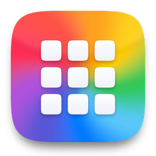
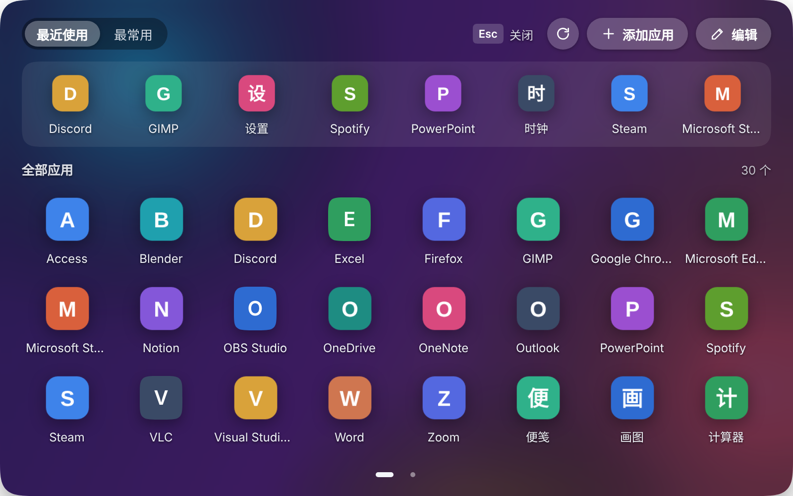
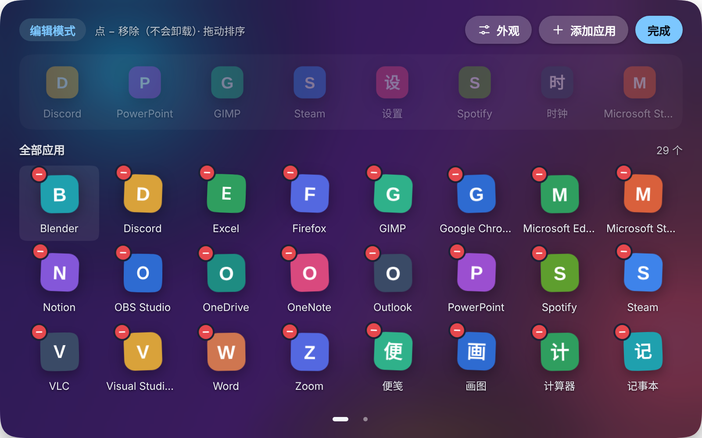
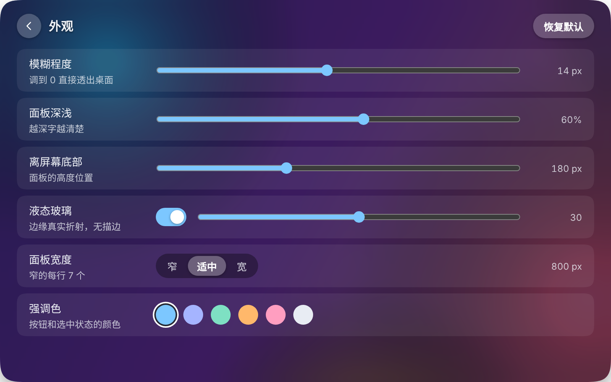
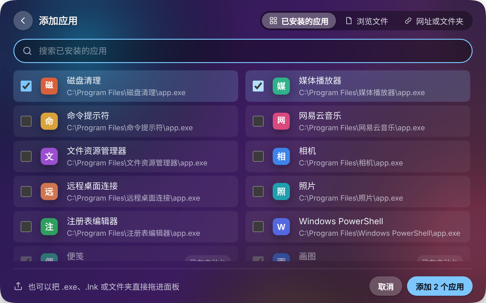

<p align="center">
  
</p>

<h1 align="center">更多应用 · NexusLauncher</h1>

<p align="center">
  给 Windows 停靠栏（比如 Winstep Nexus）配的一个应用启动台：按 <kbd>Alt</kbd>+<kbd>Q</kbd>，在屏幕下方弹出你的全部应用。
</p>

<p align="center">
  
</p>

## 功能

- **一键打开**：<kbd>Alt</kbd>+<kbd>Q</kbd>、点击托盘图标、或者点停靠栏上的「更多应用」图标，面板出现在当前屏幕下方居中；点面板外面或按 <kbd>Esc</kbd> 收起。
- **自动读取已装的应用**：从开始菜单读出所有应用（包括 Microsoft Store 应用），显示原生图标，并把大小不一的图标统一成一样大。
- **新装的软件自动出现**：开始菜单一有变化就重新扫描，新装的应用自动加到最后，名字前带个小圆点。
- **最近使用 / 最常用**：顶部一栏显示最近打开和最常打开的应用，也可以把应用「固定到最常用」。
- **编辑模式**：像 iPhone 桌面一样图标晃动，点 − 移除（不会卸载软件，可撤销），拖动排序，拖到下方圆点可以跨页。
- **添加任何东西**：从已安装应用里勾选、浏览选择 .exe / .lnk、拖文件或文件夹进面板，或者添加一个网址。
- **液态玻璃外观**：面板边缘按真实的玻璃折射扭曲背后的桌面，没有描边；模糊、深浅、宽度、高度、强调色都能在「外观」里实时调。
- **导出高清图标**：右键应用 →「导出高清图标（给 Nexus 用）」，生成 256px 的 PNG 和 ICO，解决商店应用在停靠栏上发糊的问题。
- **键盘可用**：方向键在图标间移动，<kbd>PageUp</kbd> / <kbd>PageDown</kbd> 翻页，<kbd>F5</kbd> 刷新，<kbd>Delete</kbd> 移除。

| 编辑模式 | 外观设置 | 添加应用 |
| :---: | :---: | :---: |
|  |  |  |

<sub>截图里的应用和图标是测试用的假数据，实际使用时显示的是你电脑上的应用和它们的原生图标。</sub>

## 下载安装

1. 到 [Releases](../../releases/latest) 下载 `NexusLauncher-Setup-版本号.exe`（约 110 MB，已包含全部运行环境）。
2. 双击安装：不需要管理员权限，也不需要联网，装在 `%LOCALAPPDATA%\Programs\NexusLauncher`。
3. 装好后会自动打开启动台；桌面和开始菜单里会出现「更多应用」，把它拖到 Nexus 等停靠栏上就能一键打开。

**系统要求**：Windows 10 / 11（64 位）。不依赖 Nexus，单独使用也可以。

> 安装程序没有数字签名，第一次运行时 Windows 可能提示「Windows 已保护你的电脑」，点「更多信息 → 仍要运行」即可。

**卸载**：设置 → 应用 → 已安装的应用 → 更多应用。卸载时可以选择是否保留你的应用列表和外观设置。

**再次运行安装程序**就是升级，设置和排序都会保留。

## 常见问题

**快捷键和别的软件冲突？** 托盘图标右键菜单里能看到当前快捷键；冲突时会记录在日志里。

**数据存在哪里？** `%APPDATA%\NexusLauncher`：`state.json` 是你的应用列表和设置，`icons3` 是图标缓存，`app.log` 是运行日志，`高清图标` 是导出的图标。

**后台占多少资源？** 常驻内存约 100–200 MB（Electron 程序的正常水平），平时 CPU 几乎为 0；只有打开面板和定时扫描应用时会短暂工作。

## 从源码运行和构建

需要 [Node.js](https://nodejs.org/) 18+。

```bash
npm install              # 安装 Electron 和测试用的 Playwright
npm start                # 以开发模式运行（改了 app/ 里的文件会自动重启）
npm test                 # 主进程冒烟测试 + 界面测试
npx playwright install chromium   # 第一次跑界面测试前需要
```

打包安装程序需要 Python 3 和 [Go](https://go.dev/) 1.21+，在 Linux / macOS / WSL / Git Bash 下运行：

```bash
scripts/fetch-electron.sh    # 下载 Electron Windows 运行时并校验 SHA256
scripts/build.sh             # 生成 build/NexusLauncher/ 和 dist/NexusLauncher-Setup-版本号.exe
```

修改图标：`pip install pillow numpy && python3 tools/make-icon.py`，然后把 `app/main/config.js` 里的 `ICON_VERSION` 加 1，已安装用户的快捷方式会自动换成新图标。

## 项目结构

```
app/                     程序本体（打包时放进 resources/app）
  main/                  主进程
    index.js               入口：单实例、启动顺序
    config.js              固定配置和默认设置
    store.js               用户数据读写，发给界面的数据
    scanner.js             扫描已安装应用，自动添加新装的应用
    icons.js               图标兜底、统一大小、生成 ICO
    export-icon.js         导出高清图标
    window.js              启动台窗口（位置、截取背景）
    actions.js             打开应用、以管理员运行、添加文件 / 网址
    system.js              托盘、快捷键、开机自启、快捷方式
    ipc.js                 界面可以调用的接口（含设置校验）
    dev.js                 开发模式
  preload.js             界面和主进程之间的桥（contextBridge）
  renderer/              界面：index.html、style.css、js/
  scripts/               PowerShell：scan.ps1 扫描应用，export-icon.ps1 取高清图标
  assets/                应用图标、托盘图标
installer/               Go 写的安装 / 卸载程序（只用标准库）
scripts/                 下载运行时、打包
test/                    主进程冒烟测试、界面测试和假数据
tools/make-icon.py       生成应用图标
```

## 实现说明

- **扫描应用**：PowerShell 的 `Get-StartApps` 列出开始菜单里的应用；图标通过 Windows 的 `IShellItemImageFactory` 取 96px 原生图标，取不到时用 Store 应用安装包里的图片或程序自带图标兜底。之后把图标四周的透明边裁掉，按形状算显示比例，让方形、圆形图标看起来一样大。
- **液态玻璃**：打开面板前截一张面板后方的屏幕，在界面里用 SVG `feDisplacementMap` 扭曲。位移贴图按「凸面玻璃 + 斯涅尔定律（折射率 1.5）」逐像素计算，面板中间不动、边缘折射最强；红绿蓝三个通道的偏移量略有差别，形成轻微色散。思路参考了 [kube.io 的 Liquid Glass 文章](https://kube.io/blog/liquid-glass-css-svg) 和 [liquid-glass-react](https://github.com/rdev/liquid-glass-react)（MIT），代码是重新写的。
- **圆角**：用 CSS `corner-shape: squircle` 做 iOS 那种连续曲率圆角，按钮类统一为胶囊形。
- **安全**：界面运行在沙盒里（`contextIsolation`、`sandbox`、CSP），不能直接访问系统；界面只把应用的 key 交给主进程，打开什么由主进程决定；添加网址只接受 http / https；设置值都会校验范围。
- **安装程序**：Go 标准库写成，把整个程序目录压缩后嵌进 exe；装到当前用户目录，在「设置 → 应用」里登记卸载入口。

## 已知限制

- 只支持 Windows（扫描应用、快捷方式、托盘等都依赖 Windows）。
- 安装程序和主程序都没有数字签名。
- 主程序 `NexusLauncher.exe` 本身的文件图标还是 Electron 默认图标（快捷方式、安装程序、卸载条目用的都是自己的图标）。
- 液态玻璃的背景是打开面板那一刻的截图，面板开着时后面的画面变了不会跟着变。

## 许可

[MIT](LICENSE)
